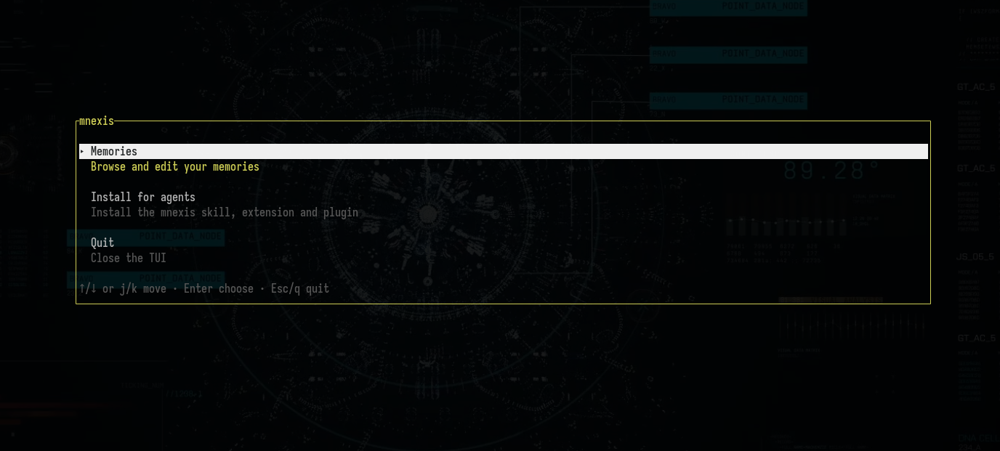

<div align="center">
  
  <h1>Mnexis</h1>
  <p><strong>Local-first memory engine for AI agents.</strong><br/>
  SQLite + FTS5, single Rust binary, no daemon, no cloud. Linux-first MVP.</p>
  <p>
    <a href="https://github.com/Xeworg/mnexis/releases/latest"></a>
    <a href="LICENSE"></a>
    
    
    <a href="https://ko-fi.com/xeworgmmm"></a>
  </p>
</div>

---

## Why mnexis

An AI agent without memory starts every session from zero: to do anything
well it has to **re-read the whole project** — the docs, the code, the
"why" behind each decision — burning time and tokens, and still losing
everything the repository does not say: what you asked for, what was tried
and rejected, the port, the constraint, the plan.

mnexis keeps that context on your machine: a local-first memory engine
(SQLite + FTS5, one Rust binary, no daemon, no cloud) where the facts,
the decisions and the sessions are stored once and retrieved in
milliseconds.

And here is the simple part: **you don't have to do anything.** Install
the extension for your agent — `pi` or `opencode`, one command — and from
then on the agent loads the project's memory at the start of every
session, saves what matters on its own, and never re-reads the whole
project again. The TUI is there for when *you* want to look.

## Install

Linux. The quick way — a published binary, verified against the checksum
the release publishes:

```sh
curl -fsSL https://github.com/Xeworg/mnexis/releases/latest/download/install.sh | bash
```

It downloads the release artifact for your platform, checks it against
`SHA256SUMS`, installs it to `~/.local/bin/mnexis` and opens the TUI. Pin
a version with `MNEXIS_VERSION`:

```sh
MNEXIS_VERSION=0.6.0 \
  curl -fsSL https://github.com/Xeworg/mnexis/releases/latest/download/install.sh | bash
```

The releases are **not signed yet**: the checksum protects against a
corrupted or truncated download, not against a compromised release. See
[docs/release.md](docs/release.md) for what that means and for how a
release is cut.

From the sources — Rust 1.95+ (`rust-toolchain.toml`) and a C toolchain
(bundled SQLite):

```sh
git clone <this-repo> mnexis
cd mnexis
./install.sh
```

The script builds the release binary with cargo and installs it to
`~/.local/bin/mnexis`, printing PATH guidance when that directory is not on
your PATH. Re-running it overwrites the installed binary. See
[docs/install.md](docs/install.md) for requirements, uninstall, and
`uninstall --purge` semantics.

An installed mnexis can update itself:

```sh
mnexis upgrade --check   # is there a newer release?
mnexis upgrade           # install it
```

To install the shipped agent skills (`skills/`, starting with
`mnexis-memory`) into an AI environment — `pi`
(`$PI_CODING_AGENT_DIR` or `~/.pi/agent/skills`) or `opencode`
(`~/.config/opencode/skills`):

```sh
./install.sh skills            # pick the environment interactively
./install.sh skills --env pi   # unattended
./install.sh uninstall --skills --env pi   # remove them again
```

The skills ship inside the binary, and the binary is a snapshot of the tree
it was compiled from: from a repository checkout the script rebuilds the
binary first when the working tree is newer than it, so the order of
`./install.sh` and `./install.sh skills` never matters. A piped
(standalone) script never rebuilds — it has no tree to compare with.

The `mnexis-memory` skill tells the agent to load the project's memory at the
start of a session (`mnexis context "<task>"`) and before it changes code
that already exists, so the decisions behind the code are never lost. One
call tells it where it may write:

```sh
mnexis context "extend the snake game with a wrap mode"   # budgeted context
mnexis search "wrap mode borde"                            # ranked search
mnexis status                                             # namespace, allowlists, recent
```

The skill is deliberately small — 1 360 bytes. What the agent needs to know
lives in the tool descriptions it already reads: a long body was measured and
read in 1 of 60 sessions, changing nothing, while the extension repairs on
its own the duplicate a second save would create.

The door carries whole facts: each item is the fact's identity and its
entire content, never a cut one — the budget decides which facts fit, not
how much of a fact you see, and the door keeps the most relevant ones — and
the answer declares what it left out, naming up to ten of the candidates the
budget could not keep, with their size, the ones closest to the cut first. A
fact that did not fit is one `mnexis show <uuid>` away.

The engine also keeps what a repository cannot: the session the agent runs
in, and what the user said.

```sh
mnexis session --id 01JX                     # register the session
mnexis prompt "el puerto es 8081"             # what the user said
mnexis prompts --search "puerto 8081"         # find it again
mnexis end --id 01JX --summary "qué hicimos"  # end it with a summary
```

A session also records **where it happened**: the branch, the commit and the
canonical key of the repository (`git:github.com-owner-repo`) — never the raw
URL, which can carry credentials. A session that did not happen in a
repository records none of it: no git is not an error.

A session belongs to the namespace the project's **memories** land in: started
from a bound workspace it lands there — so `mnexis recall --previous` answers
that session, with its window holding the memories saved during it, and
`mnexis context` carries the same session in its state block — while outside
any known workspace it keeps landing in the profile's default namespace.

What the user said belongs there too. A prompt is stored in the same
namespace, with the id of the session it was said in, so `mnexis recall
--session <id>` reads the session as a timeline and `mnexis prompts --search`
finds the words again — and the pi extension writes it **without the model**:
its `input` hook sees every message the person types, before any skill or
prompt template expands it, and stores it verbatim. A message over the content
cap (16 384 bytes) is refused whole, never truncated and never silently
shortened.

A search query is plain language: every word counts, a hyphen is part of a
word, and `--match all` narrows it to the memories that hold every word.

The engine also knows which topic it already holds: **a memory has a title**
— what the fact *is*, next to the content, which is what it says *right now* —
and the topic key derives from the title. The same title always lands on the
same record, so a fact that changed updates its record instead of adding a
second one next to it. `mnexis suggest-topic-key "<title>"` answers which key
a title yields and whether the project already records it.

A memory also carries **the words its fact is called by** in another
language or another team's jargon (`--keywords "puerto, port, listen
port"`), the full-text index covers them, and every read answer carries them
back. A save **adds** its words to the ones the record already has, so a
session that does not remember them cannot erase them; `--replace-keywords`
replaces the list when a word is wrong.

The repository also ships a pi extension that exposes the memory engine as
native tools, so an agent can store and recall project memory without being
asked to, and without choosing a namespace itself. Extensions exist for
**pi and opencode only** — no other agent environment is wired:

```sh
./install.sh extensions --env pi            # → <agent-dir>/extensions/
./install.sh uninstall --extensions --env pi
```

An installed `mnexis` can do it too — the assets travel inside the binary
(same rebuild rule as skills) —
and the TUI offers the same operation (`mnexis tui` → *Install for agents*):

```sh
mnexis agent status
mnexis agent install --env pi
mnexis agent install --env opencode
```

The two environments get different integrations, and that is deliberate:
pi receives the skill **and** the native extension (its hooks let the
extension store prompts without the model), while opencode receives the
skill, its own plugin and the MCP server wiring (`agent status` answers
the three for each environment). Anything else — Claude Code, Cursor,
whatever comes next — can still reach the engine through the MCP stdio
server (`mnexis mcp serve`), but ships no pre-packaged integration.

On a fresh profile, `mnexis init` creates the default data directory
(`~/.local/share/mnexis`) with `mnexis.db` and `mnexis.toml`; copy those two
files to migrate the profile to another machine.

```sh
mnexis init
mnexis save --namespace default "first memory"
mnexis list
mnexis search "first memory"
```

## Projects

A "project" is the user's current focus of work. mnexis scopes memories
by **namespace**, and a binding ties a workspace to the namespace an
agent writes into, so a project's memories stay together across
sessions:

```sh
mnexis project bind mnexis --key git:github.com-Xeworg-mnexis
mnexis config allow-namespace mnexis
mnexis save --namespace mnexis "a fact worth keeping"
```

See [docs/projects.md](docs/projects.md) for the identity rules, the
agent protocol, and the registry format.

## Permissions

Two permissions sit next to the namespace allowlists, and both belong to
the human:

| Permission | Default in a new profile | What it opens |
| --- | --- | --- |
| `allow_read_all` | `false` | Reading memories from any project. Off by default: a new profile reads its own namespace, plus the one its workspace is bound to. |
| `allow_global` | `false` | The reserved `global` namespace, for reads and writes. |

```sh
mnexis config allow-read-all             # open the reads across projects
mnexis config allow-read-all --revoke   # scope the reads to the allowlist
mnexis config allow-global               # open the reserved 'global' namespace
mnexis config allow-global --revoke
```

Reading another project needs a human-granted permission:
`mnexis config allow-read-namespace <ns>` opens the reading only, and the
same namespace can be bound to a workspace with `mnexis project bind`.

A profile that does not mention these keys keeps both permissions closed:
nothing opens itself silently, and `mnexis init` is what writes them
open (reads) or closed (the reserved namespace).

Reads are open across projects because projects share components, and
writes are not: the CLI refuses to write outside the namespace of the
current workspace, so an agent working in one project cannot modify
another project's memories. See
[docs/projects.md](docs/projects.md#the-agent-protocol).

## CLI

Most of the 34 commands are for the **agent**, not for you: it saves,
recalls, supersedes and audits memory on its own, and `mnexis --help`
prints the full surface when you need it (errors follow a stable
exit-code set — 0 for success, 1 reserved for infrastructure, the stable
labels from `INVALID_ARGUMENT=2` to `BUSY=10` — documented in the
[PRD](docs/PRD-Mnexis.md)). The ones a human actually types:

```sh
mnexis save --title "the fact's name" "the fact itself"
mnexis search "wrap mode"         # find it again
mnexis context "extend the game"  # what the agent will read for a task
mnexis status                     # where this workspace may write
mnexis stats                      # what every namespace holds
mnexis doctor                     # health checks (`doctor repair` fixes)
mnexis upgrade                    # self-update
```

And `mnexis tui` is the human face of the engine: the same surface,
interactive — browse and edit memories, search with `/`, the write flows
with confirmations — plus *Install for agents*, so wiring an agent
integration needs no flags at all (see [docs/tui.md](docs/tui.md)).

## TUI

<div align="center">
  
</div>

`mnexis tui` opens a full-CRUD terminal UI over the same service as the
CLI: three panes (namespaces / memories / detail), FTS5 search with `/`,
and the write flows — save (`n`), update (`e`), supersede (`s`),
soft-delete (`d`), restore (`r`) — each with validation, revision-conflict
recovery (`Ctrl-R`), and y/N confirmations. It requires an initialised
profile and enforces the profile scope. Every key is documented in
[docs/tui.md](docs/tui.md); the footer inside the TUI always shows the
keys of the current mode.

## MCP

The binary ships the MCP stdio server (`mnexis mcp serve`). Point your
MCP-capable host at the binary, with the `--data-dir` flag in the
command line. Example `mcp.json` entry:

```json
{
  "mcpServers": {
    "mnexis": {
      "command": "mnexis",
      "args": ["--data-dir", "~/.mnexis", "mcp", "serve"]
    }
  }
}
```

The server exposes 17 tools (`memory_save`, `memory_get`,
`memory_list`, `memory_update`, `memory_history`, `memory_supersede`,
`memory_delete`, `memory_restore`, `memory_search`, `memory_workspace`,
`memory_session_start`, `memory_session_end`, `memory_save_prompt`,
`memory_search_prompts`, `memory_suggest_topic_key`, `memory_recall`,
`memory_context`).
`memory_save` takes the same identity the CLI takes: `title`, `keywords`
(the comma-separated words of the fact) and `replace_keywords`.
`memory_workspace` answers "where may I write, and what is already there?"
with the same payload as `mnexis status`: the bound namespace, the read and
write allowlists, the memory count and the most recent memories — each with
its identity and a preview, never the whole record (#53).
`memory_context` is the door: give it the task in one line and the answer is
the one `mnexis context --json` prints — the memories that match the task,
best first, each with its identity and a 160-character preview, never the
whole content; the session state (the live `project_state`/`decision`
records with the content that fits the block's budget, the index of what did
not fit, and the previous session's summary); the coverage declaration (how
many candidates the budget left out, and up to ten of them with the size that
kept them out) and the namespace it searched. It searches the namespace this
workspace writes into — the one a save lands in — unless the caller names
another one it may read. All errors map to JSON-RPC code `-32050` with
`data.error_code` carrying the stable label.

## Testing

`cargo test` runs 849 tests across 25 suites (lib + binary + integration),
all green.
CI is currently the dev host's `cargo fmt --check && git diff --check
&& cargo test --all-targets` chain — there is no hosted CI yet.

The bash installer harness is separate: `bash scripts/test-installer.sh`
(see [docs/install.md](docs/install.md)).

## License

MIT. See [LICENSE](LICENSE).

## Status

<div align="center">
  
</div>

v0.6.0. Linux only. The 500-memory/150-query
evaluation
fixture is not yet committed; the spike corpora (`docs/t14-fts5-benchmark.md`)
are the only measured quality evidence at the moment. See `odd/tasks/`
for the implementation record.
